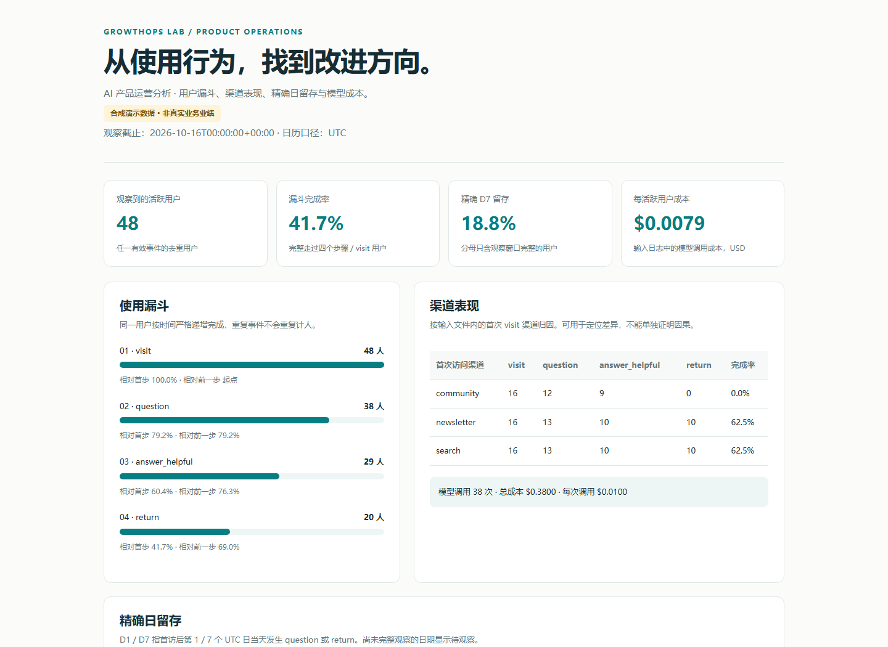

# GrowthOps Lab

**AI 产品运营分析工具：把事件导出文件变成可复核的漏斗、渠道、留存和成本报告。**

面向想练习或执行产品运营分析的人。用 Python 标准库离线读取 CSV，生成可直接打开的 HTML 报告，并保留 JSON 和 CSV 结果。无数据库、无服务端部署、无付费 API、无第三方运行依赖。

> 当前为独立实现的 v0.1.0 原型。默认演示全部使用合成数据，不代表真实用户、实际增长或商业成效。项目采用 AI 辅助开发；代码和规则应由使用者结合业务口径复核。





## 一分钟运行

需要 Python **3.11 或更高版本**。在仓库根目录运行：

```bash
git clone https://github.com/LeiQingliang/growthops-lab.git
cd growthops-lab
python -m growthops demo --output artifacts/demo
```

直接用浏览器打开 `artifacts/demo/report.html`。同目录还会生成：

| 文件 | 用途 |
| --- | --- |
| `synthetic-events.csv` | 48 个虚构用户的可重复演示事件，含故意设置的质量问题 |
| `report.json` | 指标、定义、观察截止时间、质量统计 |
| `funnel.csv` | 用户级顺序漏斗 |
| `channels.csv` | 首次访问渠道的分步骤转化 |
| `cohorts.csv` | 精确 D1/D7 留存，分母与待观察数量 |
| `issues.csv` | 被拒绝或排除的数据行及原因 |

空结果对应的 CSV 可以为空文件；JSON 始终保留对应列表。HTML 不加载外部字体、脚本或跟踪资源。

## 能解决什么问题

- **用户在哪一步停止？** 计算 `visit → question → answer_helpful → return` 四步用户漏斗。
- **渠道是否存在差异？** 按用户首次访问渠道拆解每个步骤。
- **用户是否在第 1/7 天回来？** 精确日留存只让已完整观察的用户进入分母。
- **成本对应多少使用？** 合计输入日志中的模型调用成本，计算每观察活跃用户与每次调用成本。
- **输入是否可信？** 检查重复 ID、缺失用户、异常时间、负数或非有限成本，并输出行级问题清单。

## 分析自己的事件

```bash
python -m growthops analyze --input examples/events.csv --as-of 2026-10-16T00:00:00Z --output artifacts/analysis
```

`--as-of` 必填，它是**包含边界的观察截止时刻**，须带时区。工具统一转换到 UTC，并排除晚于截止时刻的数据。不要把分析运行时间当成数据完整时间：导出文件的数据实际覆盖范围仍需自行核实。

CSV 必须包含以下列，可有其它列：

| 字段 | 要求 / 示例 |
| --- | --- |
| `event_id` | 非空、事件唯一 ID，例如 `evt-0001` |
| `user_id` | 非空匿名用户 ID，例如 `anon-001` |
| `timestamp` | 带时区的 ISO 时间，例如 `2026-10-01T09:00:00Z` 或 `2026-10-01T17:00:00+08:00` |
| `event` | `visit`、`question`、`answer_helpful`、`return`、`model_call` 之一 |
| `channel` | 首次访问渠道；空值转为 `unknown` |
| `cost_usd` | 非负有限数，只允许 `model_call` 非零；空值按 0，单行上限 10 亿 USD |

`answer_helpful` 应来自明确的用户认可或独立的任务成功定义；工具不会自动认定回答有帮助。`return` 是导入者提供的“再次使用”事件，不由工具自动推断，**不等同于 D1/D7 留存**。

事件按时间排序；漏斗四步的时间必须**严格递增**，相同时刻不能推进下一步。重复的有效 `event_id` 保留第一条，后续记录拒绝；晚于截止时间的记录不参与去重或指标。所有问题都在 `issues.csv` 留痕。

### 接收 PostHog 等系统的文件导出

本项目只有**CSV 文件级互操作**，没有在线连接 PostHog、没有接入其 SDK，也不读取账号凭据。需要先把原始事件导出并整理成上述数据语义。

如果导出列名为 `uuid`、`distinct_id`，可使用提供的字段映射：

```bash
python -m growthops analyze --input your-export.csv --mapping examples/posthog-column-map.json --as-of 2026-10-16T00:00:00Z --output artifacts/imported
```

映射仅重命名 CSV 列，不解析嵌套 `properties`、不重命名事件值、不自动合并匿名和登录用户。你需要先在导出查询中展开 `channel`、`cost_usd` 并规范事件名称。不同 PostHog 导出形式并不都能直接使用此示例。

## 指标口径

- **漏斗：** 输入文件内首次 `visit` 为起点；同一用户严格按时间依次完成四步；每步只计一次；没有会话限制或转化时间窗。
- **渠道：** 首次 `visit.channel` 归因，不是多触点归因。无 `visit` 的用户不会进入漏斗或 cohort。
- **留存：** 用户首个 `visit` 的 UTC 日期作为 cohort；第 1 或 7 个 UTC 日当天出现 `question` 或 `return` 算留存。不是滚动 24 小时，也不是“第 N 天及以后”。
- **截尾：** 目标 UTC 日结束后才进入分母。例如 D7 目标日为 10 月 8 日，截止至少为 10 月 9 日 00:00 UTC 才可纳入。未成熟 cohort 显示 `null` / 待观察，而非 0%。
- **成本：** 仅累加 `model_call.cost_usd`，不估算 token 单价。当前全部视为 USD；不会换汇。每活跃用户分母为观察期内出现任意有效事件的去重用户，**不代表已约定的业务活跃标准**。
- **空分母：** 比例和单位成本为 `null`，HTML 显示待观察或破折号。

详细的运营解读和数据限制见 [指标与运营方法](docs/metrics-and-operations.md)。

## 复核与测试

```bash
python -m unittest discover -s tests -v
```

测试覆盖严格顺序和同刻事件、重复记录、首触渠道、UTC 日期、精确留存与观察截尾、成本分母、空输入、字段映射、HTML 转义、CSV 公式保护、可重复演示和命令输出。

示例固定截止时间为 `2026-10-16T00:00:00Z`。所有数字都是合成事件计算结果，便于复核，不应作为简历或商业案例中的真实业绩。

## 项目结构

```text
growthops/       CSV 校验、指标计算、报告与命令入口
examples/        合成事件与字段映射
tests/           标准库 unittest
docs/            指标定义与运营解读
artifacts/       本地生成结果（已忽略，不提交）
```

## 参考、归属与边界

本项目参考 [PostHog](https://github.com/PostHog/posthog) 所覆盖的产品分析工作场景，采用独立代码实现。不是 PostHog 的 fork、官方扩展或替代品，也没有复制其源代码。功能仅限本文明确列出的离线计算。

当前版本专注于离线文件分析；线上数据接入、实验因果推断、会话级漏斗和跨身份合并尚未实现。

所有分析均在本机进行。演示文件和默认报告写入已忽略的 `artifacts/`；真实输入建议放在已忽略的 `private-data/`。导入真实记录时，应使用已获授权的数据和匿名 ID。贡献代码前运行测试，描述具体计算问题和可复现样例即可。

代码采用 [MIT License](LICENSE)。

## 配套实践项目

- [supportops-studio](https://github.com/LeiQingliang/supportops-studio)
- [evalops-workbench](https://github.com/LeiQingliang/evalops-workbench)
